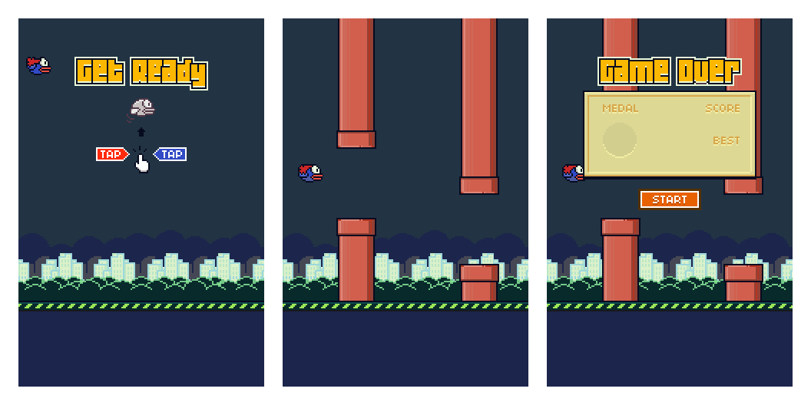

<div align="center">

# 🐦 Flappy Hero

**Um jogo 2D no estilo "voe entre os canos", feito com HTML Canvas e JavaScript puro.**

Projeto desenvolvido para a faculdade, com o objetivo de colocar em prática o que aprendi sobre a API de Canvas do HTML.

[](https://karlos-silva.github.io/flappy-hero/)




</div>

---

## 🎓 Sobre o projeto

O **Flappy Hero** nasceu como um trabalho da faculdade em outubro de 2024. A proposta era sair da teoria e construir algo que funcionasse de verdade usando só o que o navegador oferece: nada de engine, framework ou bundler. Só um `<canvas>`, um arquivo JavaScript e uma folha de sprites.

No caminho, o projeto me fez praticar:

- 🖼️ **Desenho no Canvas**: recortar sprites com `drawImage` e montar a cena camada por camada
- 🔁 **Game loop**: atualizar e redesenhar tudo a cada quadro com `requestAnimationFrame`
- 🍎 **Física simples**: gravidade, velocidade e impulso do pulo
- 💥 **Detecção de colisão**: com o chão e com os canos
- 🎬 **Animação por quadros**: o bater de asas do pássaro
- 🧭 **Máquina de estados**: as telas de início, jogo e game over
- 🔊 **Áudio**: efeitos sonoros com a API `Audio`

## 🕹️ Como jogar

| Ação | Controle |
| --- | --- |
| Começar a partida | Clique, toque ou `Espaço` |
| Bater as asas | Clique, toque ou `Espaço` |
| Recomeçar após o Game Over | Clique, toque ou `Espaço` |

Desvie dos canos e não encoste no chão. Quanto mais tempo você sobreviver, maior a pontuação no canto da tela.

## 🚀 Rodando localmente

Não tem nada para instalar. Clone o repositório e abra o `index.html` no navegador:

```bash
git clone https://github.com/karlos-silva/flappy-hero.git
```

```bash
cd flappy-hero && open index.html
```

> No Linux, troque `open` por `xdg-open`. No Windows, é só dar dois cliques no arquivo.

Se o navegador bloquear os sons ou as imagens ao abrir o arquivo direto, suba um servidor estático rapidinho:

```bash
npx serve .
```

## 🧩 Como o código está organizado

```
flappy-hero/
├── index.html      # página com o <canvas> de 320×480
├── jogo.js         # toda a lógica do jogo
├── sprites.png     # folha de sprites (pássaro, canos, cenário, mensagens)
├── efeitos/        # efeitos sonoros (.wav)
└── docs/
    └── preview.png # imagem usada neste README
```

O `jogo.js` é dividido em pequenos objetos, cada um com seus métodos `desenha()` e `atualiza()`:

| Objeto | Responsabilidade |
| --- | --- |
| `planoDeFundo` | Pinta o céu e repete a cidade ao fundo |
| `criaChao()` | Chão que rola em loop infinito para dar sensação de movimento |
| `criaFlappyBird()` | O herói: gravidade, pulo, animação das asas e colisão com o chão |
| `criaCanos()` | Gera pares de canos com altura aleatória e checa colisão |
| `criaPlacar()` | Conta e desenha a pontuação |
| `Telas` | Máquina de estados com `INICIO`, `JOGO` e `GAME_OVER` |

O ciclo de cada quadro é bem direto:

```js
function loop() {
  telaAtiva.desenha();   // desenha a tela atual
  telaAtiva.atualiza();  // avança a física e a lógica
  frames = frames + 1;
  requestAnimationFrame(loop);
}
```

### ⚙️ Números que dão o "feeling" do jogo

| Constante | Valor | O que faz |
| --- | --- | --- |
| `gravidade` | `0.25` | Quanto a velocidade de queda aumenta a cada quadro |
| `pulo` | `4.6` | Impulso para cima a cada clique |
| Velocidade dos canos | `2px` / quadro | Quão rápido o cenário vem na sua direção |
| Novo par de canos | a cada `100` quadros | Distância entre um obstáculo e outro |
| Vão entre os canos | `90px` | Espaço livre para o pássaro passar |

Quer deixar o jogo mais difícil? Mexa nesses valores e veja o que acontece. 😉

## 📄 Licença

Distribuído sob a licença MIT. Veja o arquivo [LICENSE](LICENSE) para mais detalhes.

<div align="center">

Feito com ☕ e muitos `drawImage` por **[Karlos Silva](https://github.com/karlos-silva)**

</div>
